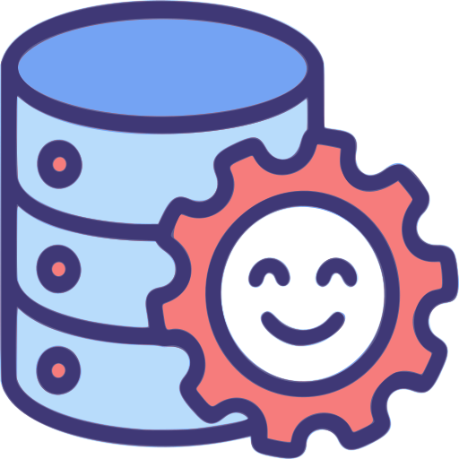

<p align="center">
  
</p>

<h1 align="center">HappyCMDB</h1>

<p align="center">
  Open-source Configuration Management Database (CMDB) with graph-based relationship modeling, AI-powered discovery, and 43 integration connectors.
</p>

<p align="center">
  <a href="LICENSE"></a>
  <a href="https://www.typescriptlang.org/"></a>
  <a href="https://nodejs.org/"></a>
</p>

## What Is This

HappyCMDB is an enterprise CMDB platform that discovers, maps, and tracks infrastructure across multi-cloud and on-premise environments. It stores configuration items (CIs) and their relationships in a Neo4j graph database, syncs to a PostgreSQL analytics data mart, and exposes everything via REST and GraphQL APIs.

### Key Capabilities

- **43 Integration Connectors** (17 TypeScript + 26 JSON declarative) — AWS, Azure, GCP, ServiceNow, Jira, VMware, Kubernetes, SCCM, Datadog, and more
- **AI-Powered Discovery** — LLM-based infrastructure discovery (Anthropic, OpenAI) with automatic pattern learning that compiles successful discoveries into reusable zero-cost patterns
- **Graph-Based Relationships** — Neo4j models CI dependencies, hosting, and connectivity for impact analysis and dependency mapping
- **ITIL v4 + TBM v5 + BSM** — Built-in service management, cost transparency, and business service impact frameworks
- **Hybrid Discovery** — Network protocols (NMAP, SSH, SNMP, Active Directory) via agents + cloud/SaaS APIs via connectors
- **Unified Credentials** — Protocol-based authentication with encrypted storage and affinity matching
- **Analytics Data Mart** — PostgreSQL with TimescaleDB for reporting, with ETL pipeline from Neo4j
- **Event Streaming** — Kafka-based pipeline for real-time CI change processing
- **React Dashboard** — 5 executive dashboards (CIO, ITSM, FinOps, Business Service, Executive)
- **REST + GraphQL APIs** — 20+ endpoints with JWT authentication

**Discovery egress restriction:** Discovery workers and AI discovery tools refuse loopback, link-local, RFC1918/ULA, cloud metadata addresses, and platform service names for every caller, including administrators. Private/internal discovery is unavailable until a separately reviewed dedicated platform-admin (P-6) and per-organization CIDR allowlist change lands. Discovery agents are visible and mutable only within the caller's verified organization; legacy agents without an organization are inaccessible to everyone. See [the discovery egress and registry design](docs/discovery-egress-agent-registry-design.md).

**Legacy job history limit:** Authenticated queue and discovery listing APIs reject start/offset positions above 10,000 with HTTP 400 `Deep job pages unavailable` before querying Redis; malformed pagination returns `Invalid job pagination`. History beyond that position is not reachable through these listing APIs; positions are BullMQ queue/state offsets, not tenant-owned ranks. Pagination below the cap remains bounded and tenant-filtered, including larger requested limits on `/jobs/discovery`. Newly registered AD, SNMP, and AI discovery queues are readable within a tenant, but generic cancel/retry on those queues return `Queue mutation unavailable` until their mutation authorization is reviewed. See the [OpenAPI listing contract](packages/api-server/src/openapi/openapi.yaml); per-organization index/cursor migration is deferred to HAP-551.

**Jobs CLI tenant boundary:** `cmdb jobs list <queueName>`, `status`, `retry` and `cancel` require a JWT (`--token`/`CMDB_ACCESS_TOKEN`) or API key (`--key`/`CMDB_API_KEY`) and use the authenticated `/api/v1/jobs` routes. The API verifies organization ownership; foreign, missing and orgless IDs cannot be distinguished from CLI output, and raw worker results, progress, failures, stack traces and configuration are never printed. Direct Redis/DB credentials on the CLI are infrastructure access, **not** a tenant identity. `cmdb jobs stats` and `cmdb jobs run:etl` exit nonzero with the fixed message `Queue operations require the authenticated API; global operations unavailable` without contacting BullMQ or the scheduler. Global queue and ETL schedule operations stay unavailable until a separately authorized platform-operations API exists (HP1-S6/P-6).


## Architecture

```
┌─────────────────────────────────────────────────────────────┐
│                     Presentation Layer                       │
│  ┌────────────┐  ┌────────────┐  ┌────────────────────┐    │
│  │  React UI  │  │  CLI Tool  │  │  External Systems  │    │
│  └────────────┘  └────────────┘  └────────────────────┘    │
└────────────┬───────────────┬──────────────────┬─────────────┘
             │               │                  │
┌────────────▼───────────────▼──────────────────▼─────────────┐
│              REST API + GraphQL (Express + Apollo)           │
└────────────┬──────────────────────────────────┬──────────────┘
             │                                  │
┌────────────▼──────────────────────────────────▼──────────────┐
│   Discovery Engine │  ETL Processors  │  Event Streaming     │
└────────────┬──────────────────────────────────┬──────────────┘
             │                                  │
┌────────────▼──────────────────────────────────▼──────────────┐
│  Neo4j (Graph)  │  PostgreSQL (Mart)  │  Redis (Cache/Queue) │
└───────────────────────────────────────────────────────────────┘
```

## Quick Start

**Prerequisites**: Docker >= 20.10, Docker Compose >= 2.0, Node.js >= 20

```bash
git clone https://github.com/Happy-Technologies-LLC/happycmdb.git
cd happycmdb
cp .env.example .env
./deploy.sh --seed
```

Access points after deployment:
- **Web UI**: http://localhost:3001
- **API**: http://localhost:3000
- **GraphQL Playground**: http://localhost:3000/graphql
- **Documentation**: http://localhost:8080

### Manual Setup

```bash
npm install
cp .env.example .env
docker-compose -f infrastructure/docker/docker-compose.yml up -d
./scripts/db-init.sh
npm run build
npm run dev:api
```

### ITIL baseline tenant ownership

Migration `012_itil_baseline_organization_scope.sql` adds the nullable baseline owner. New REST baselines snapshot only CIs owned by the authenticated organization and are stamped from that claim. Baseline list, detail, comparison, restore, and DELETE require a matching owner; comparison returns the existing response only for an owned baseline, and restore updates only CIs in the same organization. Foreign and missing baseline IDs have identical not-found responses. Older baselines have a NULL owner and cannot be listed, read, compared, restored, or deleted by any current role (including admin and the default organization). Do not infer ownership or backfill these rows from their snapshots; dedicated platform-admin authority is required before a legacy-access policy can be introduced.

Migration `013_itil_baseline_org_name_unique.sql` replaces global baseline-name uniqueness with uniqueness within each non-NULL organization. A caller can reuse a name held by another organization or an inaccessible legacy row; a duplicate name within the caller's organization returns 409 without database error details. Older unscoped service writers that still omit `organization_id` create NULL-owner rows, which remain inaccessible to REST callers; they cannot be attributed to a tenant without a verified organization claim.

### CI incarnation boundary for derived PostgreSQL rows

Graph CIs receive an immutable `incarnation_id` in their creation statement. Migration `025_ci_derived_incarnation.sql` adds nullable, indexed `ci_incarnation_id` columns to baseline snapshots, drift results, impact analyses, criticality scores, and CI change history. Derived writers prove the CI's current graph organization and stamp its incarnation; tenant reads match that graph incarnation exactly. Pre-migration rows with a NULL marker and surviving rows from a deleted/re-created CI ID remain unreadable, regardless of timestamps or historical owner metadata. An owned legacy graph CI gets a marker atomically on its next derived write; older NULL SQL rows are not backfilled. Graph deletion best-effort purges only the deleted incarnation and NULL legacy rows across the five SQL families, preserving derivatives of a new graph CI reusing that ID. A committed graph deletion returns success even if SQL cleanup fails; the UUID fence still makes stale rows unreadable. Change timeline and GraphQL change frequency cap graph enumeration at 512 tenant CIs (including legacy CIs), return a fixed resource-limit error above that cap, and never pass an unbounded graph JSON payload to SQL. The migration is shipped as source; apply it only through the separately approved fresh-database staging migration window, not from this development session.

### Authenticated role source of truth

REST, GraphQL and integration-hub requests authorize JWTs using the enabled user's current role, not the role embedded in a previously issued access token. API keys use the less-privileged of their stored role and the enabled user's current role, compared by granted permissions; incompatible roles (for example, `agent` and `viewer`) are rejected rather than granting either role's exclusive permissions. Missing or disabled users are denied. The request organization remains the user's freshly loaded organization, not a token claim.

`POST /api/v1/auth/login` and `/refresh` use the same fixed HTTP 401 `{ "success": false, "error": "Authentication failed" }` for credential, account, and store failures; bearer/API-key middleware returns one fixed unauthorized body and GraphQL returns `UNAUTHENTICATED`. Server-side diagnostics record only credential type and a bounded reason (invalid, expired, wrong type, disabled, revoked, or store error), never the credential or database error text.

Issuing an API key through `POST /api/v1/auth/api-key` requires a verified JWT access token from a user login session. An API key cannot issue another key, even after its owner gains a higher role; API-key-authenticated requests to this endpoint receive HTTP 403. Missing or disabled users remain unauthenticated (HTTP 401).

Account operations require a verified JWT user session: `PUT /api/v1/auth/profile`, `PUT /api/v1/auth/password`, `DELETE /api/v1/auth/account`, `GET /api/v1/auth/api-keys`, and `DELETE /api/v1/auth/api-key/:keyId`. A verified API key of any role receives the same HTTP 403 (`JWT user session required`) before route validation or account access. Missing or disabled users receive HTTP 401. Key creation remains session-only. The mounted GraphQL schema has no account, password, API-key, MFA, or security-profile operation; REST has no key rotation, session reset, or MFA/security-profile endpoint.

### Interim platform-administrator boundary

Until the dedicated platform-admin flag (HP1-S6/P-6) is implemented, authenticated requests to global TBM summary, tower, allocation, GL import, and license routes receive HTTP 403 with the fixed error `Platform administrator access unavailable`. TBM GraphQL fields are not mounted in production; their source resolvers would return the same error with `FORBIDDEN` if mounted. Global REST connector install/update/uninstall/verify/cache-refresh controls and GraphQL `installConnector`, `updateConnector`, and `uninstallConnector` are refused the same way. Tenant admin roles, admin API keys, and organization headers do not grant access. TBM service/capability costs and organization-scoped trends remain available only for the verified caller organization (trends retain their admin permission); foreign and missing service/capability IDs are indistinguishable.

### Tenant graph reads and cost traversals

Authenticated relationship list/type/filter counts, creation and deletion require a verified organization on both CI endpoints; a foreign or NULL-owned endpoint is treated like a missing one. Advanced/full-text/relationship/orphan search filters candidates inside Neo4j before counting, ordering or limiting. REST and production GraphQL reconciliation match search only caller-owned candidates. Architecture POST analysis rejects any requested foreign, NULL-owned or missing CI before running the engine or storing a result; both POST and business-service GET constrain every dependency path and neighbor used for issues, fan-in/out, depth, redundancy and resource counts to caller-owned CIs inside Neo4j. Stale business-service mappings to foreign or NULL-owned CIs are excluded before analysis. Tenant TBM service/capability costs include only caller-owned CI nodes and deduplicate graph paths by CI identity, not by equal cost values. TBM GraphQL cost resolvers use the same traversal, but **TBM GraphQL fields are not mounted in the production schema**; this does not enable them. Staging remains at 85f0751 pending the web-ui build repair and Nick's STG-MIG receipt or explicit deployment acceptance; merges are held. Parked #47 overlaps relationship/search paths and must rebase after T2–T6.
Orphan search excludes an owned CI only when it links to a node carrying the caller's `organization_id`. Owned CI and BusinessService links count; foreign and NULL-owned neighbors do not. ApplicationService, BusinessCapability and ValueStream currently have no `organization_id` or backfill, so links only to those NULL-owned nodes do **not** prevent a CI from being reported orphaned. This note does not change the search predicate.

Architecture analysis accepts at most 20 CI IDs in `POST /api/v1/architecture/analyze` (HTTP 400 before ownership reads if exceeded). Business-service GET rejects services with more than 20 distinct mapped CI IDs (HTTP 503 before graph work), even when some mappings are stale or foreign; repeated mapping types for one CI count once, and foreign and missing services still share HTTP 404. Both entry points traverse caller-owned dependencies to a fixed depth of 10 hops, retaining detection of 2–10-edge owned cycles; `circular_dependencies: 0` means none detected within that supported range, not proof that longer cycles do not exist. The traversal expands at most 1,000 distinct one-hop path/neighbor rows across all requested roots. Exceeding the expansion budget returns HTTP 503 rather than partial results. The two analysis routes share fixed-window admission limits (10 requests/minute and one concurrent request per verified principal; 40 requests/minute and two concurrent requests per tenant); refusal is a fixed 429 before ownership preflight. Limiter state holds at most 2,048 keys and rejects new identities when full. A 20-second end-to-end request deadline includes ownership lookup, business-service mapping, graph work and PostgreSQL persistence. Neo4j statements retain the tighter five-second timeout; PostgreSQL mapping and persistence run inside transactions with transaction-local `statement_timeout` capped by the remaining request budget. Timeout yields a fixed 504 and resource exhaustion a fixed 503. Timed-out responses do not release a concurrency slot until their underlying work settles.

Impact criticality analysis skips cycle/self-loop edges, caps recursion at 12 levels and 100 visited nodes per direct request, and returns a fixed 503 without partial cache writes when either budget is exceeded. A walk that encounters a cycle returns its bounded root score but does not cache any scores from that walk: skipped back-edges make descendant scores depend on which CI was requested first. Acyclic walks still persist scores. Impact prediction expands distinct, owned dependent nodes one hop at a time: five hops for affected CIs, ten for the critical chain, with at most 100 discovered nodes and one shared 100-unit budget across both traversals and criticality visits. An over-budget prediction returns fixed 503 before persisting analysis or criticality cache. Critical path is now the deepest shortest `DEPENDS_ON` chain reached within that budget, not the longest simple path through revisited nodes. Parallel relationships do not multiply paths. All Neo4j statements retain five-second transaction timeouts as a backstop.

Authenticated `GET /api/v1/impact/graph/:rootCiId` accepts `max_depth` 1–5 (default 3). One-hop frontier Cypher expands distinct owned nodes per level rather than variable-length paths; each edge query has integer `LIMIT 201`, and the bounded metadata query has integer `LIMIT 101`. At most 100 nodes and 200 unique edges may be returned, with a shared 400-unit request budget charging adjacency rows, metadata rows, every criticality visit and pending cache writes. Exceeding a cap returns fixed 503 without a truncated graph or partial cache write. Tests cover bounded graph and prediction traversals with real parallel-edge and fan-out-by-depth topology in disposable Neo4j (`packages/api-server/tests/integration/t3-tenant-boundary.test.ts`), plus mounted graph semantics (`packages/api-server/src/rest/routes/__tests__/impact-criticality.routes.test.ts`). The five-second Neo4j statement timeout is a backstop; staging load validation remains necessary.

Impact criticality and graph-node metadata count caller-owned incoming and outgoing relationships in separate scoped Cypher subqueries. This preserves per-relationship counts (including parallel relationships) without multiplying high-degree inbound × outbound rows. The disposable Neo4j integration test profiles both statements on a 300-in/300-out owned hub and checks the small owned graph's counts.

REST `GET /api/v1/cis/:id/{relationships,dependencies,impact}` and GraphQL `getCIDependencies`, `getImpactAnalysis`, and nested CI `_dependencies` expand owned CIs through bounded one-hop frontiers (depth 1–10, default 5 except relationships default 1). Each traversal is limited to 100 distinct visited CIs and 400 adjacency rows, including parallel relationships; composite REST impact and fields in one GraphQL request share their respective work budgets. Statements use a five-second timeout and reject exhausted work with fixed REST 503 / GraphQL `SERVICE_UNAVAILABLE`, never truncated output. REST dependencies return one shortest path per reachable CI rather than every distinct path through a diamond; impact distances are shortest-hop distances. Small acyclic path/edge and tenant behavior is unchanged. Disposable real Neo4j tests cover parallel edges and 1→10→100 fan-out across REST and GraphQL.

GraphQL sibling CI traversal aliases queue their one-hop statements on the request's shared work budget: each statement reserves its maximum row allowance before dispatch, refunds unused rows after completion, and cannot start a second over-budget expansion. REST relationships at depth greater than one report the actual owned edge's source and target CIs, never the requested root as a fabricated endpoint.

GraphQL admission allows four active requests per verified principal and eight per tenant. Slots remain held until the HTTP response finishes, including while the socket writes after Apollo completes resolver work; the absolute write-phase deadline `GRAPHQL_RESPONSE_WRITE_DEADLINE_MS = 30_000` starts at `willSendResponse` and destroys a stalled response/socket after 30 seconds, releasing its slot. This timer does not limit resolver or DB execution time.

The default, no-service-ID business-service dashboard returns the existing static four service-health rows without querying Neo4j or deriving a CI count; it returns HTTP 200 even for tenants with more than 100 active CIs. Dynamic service health needs a separate data contract. The explicit service-ID dashboard still checks ownership and bounds its tenant-scoped dependency frontier to 100 distinct CIs and 400 adjacency rows, with fixed refusals and five-second graph statement timeouts.

Executive, CIO, FinOps and ITSM dashboards aggregate caller-owned CIs in Neo4j rather than transferring a tenant-wide CI list. Cost/category sums and status/tier counts include every matching CI; detail samples are limited to 10 cost/risk rows or five value/optimization/CI-status rows before transfer. Each graph statement has a five-second timeout. More than 100 distinct cost towers or ITSM statuses returns fixed HTTP 503 `Dashboard aggregate resource limit exceeded` rather than a partial dashboard; graph transaction expiry returns fixed HTTP 504 `Dashboard analysis timed out`. All four global routes share the Business Service dashboard's verified-principal (10/min, one active) and tenant (40/min, two active) admission slots; refusal is fixed HTTP 429. Global requests have a 20-second end-to-end deadline and return fixed HTTP 504 on expiry; unexpected failures return fixed public HTTP 500 without graph diagnostics. Business Service retains its existing five-second request deadline.

Impact GET/POST routes share the architecture verified-principal (10/min, one active) and tenant (40/min, two active) admission runner, with a 20-second end-to-end deadline for preflight, graph work and PostgreSQL statements; fixed 429/503/504 on rate, resource and timeout refusals. The rate/concurrency table is per API process. Criticality still counts every owned incoming relationship exactly, but transfers at most 101 distinct dependent IDs from Neo4j and refuses over-100 unique dependencies before cache writes. Real-Neo4j 130-distinct/150-relationship coverage and mounted concurrent/deadline regressions enforce this contract.

## Repository Structure

| Package | Description |
|---------|-------------|
| `packages/common` | Shared types, utilities, logging, validation, security |
| `packages/database` | Neo4j, PostgreSQL, Redis clients and BullMQ queue manager |
| `packages/api-server` | REST (Express) + GraphQL (Apollo) API server |
| `packages/discovery-engine` | Connector orchestration, job routing, enrichment pipeline |
| `packages/etl-processor` | Neo4j → PostgreSQL data mart sync, reconciliation |
| `packages/agent` | Lightweight discovery agent (NMAP, SSH, SNMP) |
| `packages/cli` | Command-line interface |
| `packages/ai-discovery` | LLM-powered discovery with pattern learning |
| `packages/ai-ml-engine` | Anomaly detection, drift detection, impact prediction |
| `packages/integration-framework` | Base connector framework, auth adapters, registry |
| `packages/data-mapper` | Field mapping and transformation engine |
| `packages/identity-resolution` | Cross-source entity matching and deduplication |
| `packages/itil-service-manager` | ITIL v4 incident, change, and problem management |
| `packages/tbm-cost-engine` | TBM v5.0.1 cost allocation and financial analysis |
| `packages/bsm-impact-engine` | Business service impact analysis |
| `packages/unified-model` | Shared domain model across ITIL, TBM, BSM |
| `packages/event-streaming` | Kafka event pub/sub infrastructure |
| `packages/event-processor` | Event consumer and change processor |
| `packages/framework-integration` | Adapter layer between frameworks |
| `packages/integration-hub` | Integration orchestration |
| `packages/connectors/*` | 43 connectors (17 TypeScript + 26 JSON-only) |
| `web-ui` | React dashboard with TailwindCSS |
| `doc-site` | VitePress documentation site (80+ pages) |
| `infrastructure` | Docker, Kubernetes, Terraform, monitoring configs |

## Connector organization and secret handling

Connector configurations and runs are scoped to the authenticated user's verified organization. REST `/api/v1/connector-configs`, GraphQL connector operations, and the standalone integration hub `/api/v1/connectors` do not accept a caller-supplied organization as authority. Configuration `connection`, `options`, and resource configuration values are write-only: responses do not return saved secrets. Keep the original secret in your own vault when editing.

**Compatibility change (R-CRED-2):** Connector execution, connection tests, and validation refuse **every** configuration with a stored `credential_id`, including platform-admin and legacy configurations, before looking up or decrypting the referenced credential. The response is a fixed, non-identifying `Connector credential reference unavailable` error (`409` on REST/hub); such runs are not queued. Inline connection configurations still work within their owning organization. Legacy configurations without an organization never run automatically. This restriction remains until a separately reviewed credential-ownership change after HP1; the connector migration does not change the credentials table.

Only a verified platform-admin marker grants access to historical NULL-organization connector configurations. The normal `admin` role does not. In the standalone hub, platform admins with their own organization use `?legacy=true` to select a same-named historical configuration; without it, name lookups select their own organization. See [connector API/security contract](docs/connector-org-security-design.md).

REST `POST /api/v1/connector-configs/:id/run` retains its existing queued-history behavior; this repository has no consumer that dispatches that row, so HTTP 202 does **not** prove execution. The integration hub and GraphQL run through `IntegrationManager` instead.

## Roadmap

- **Connector SDK** — Standalone SDK for building custom connectors for any REST/GraphQL API
- **AI Discovery Module** — Standalone AI-powered infrastructure discovery with pattern learning
- **Terraform Provider** — Manage HappyCMDB resources as infrastructure-as-code
- **Helm Chart** — Production Kubernetes deployment with auto-scaling

## Development

```bash
npm run dev               # Start all services in dev mode
npm run build             # Build all packages
npm run test:unit         # Unit tests
npm run test:integration  # Integration tests (requires Docker services)
npm run lint              # ESLint
npm run format            # Prettier
```

HP1 S3 audit gate: `packages/api-server/src/__tests__/hp1-s3-source-gates.test.ts`
scans deployable TypeScript, committed JavaScript, package SQL, and deployed
`infrastructure/database` SQL (Metabase initialization and all three views)
for unbound audit writers, legacy `log_ci_change` trigger installation, and
raw discovery job serialization. Full-text search counts index hits without
collecting nodes and separately reads the ordered, tenant-scoped limited page.
Top-connected REST/GraphQL rows and both relationship endpoints require current,
non-backfilled, non-pending dimensions and current graph ownership; candidate
pages and graph verification have bounded size and a shared deadline, with a
503/resource-limit response rather than an incomplete ranking. Architecture
analyses exclude pending/failed neighbors from cycles, counts, and issue details;
the existing traversal budgets still apply. Discovery execution remains disabled
until the separately authorized S5 cutover: its workers only scrub old payloads.

The N-18 persisted queue proof is deliberately outside default integration
discovery. Nick alone runs the founder-approved, disposable Build01 Docker
receipt against a clean checkout of the exact draft PR head with locked npm
dependencies already installed:

```bash
./packages/etl-processor/tests/scratch/run-n18-receipt.sh <exact-40-character-PR-head-SHA>
```

The script pins the linux/amd64 Neo4j, TimescaleDB and Redis images by digest,
binds only disposable loopback ports, loads the canonical schema, runs the real
registered processors, and removes only its own labeled containers on both
success and failure. It writes `test-results/n18/<sha-prefix>-<pid>.jsonl`
(persisted returnvalue, logs, failedReason, stacktrace, data and marker status
per case) and `.run.log` (57-case table, exact head and teardown/exit status).
Agents must not run this script. The fixture covers eight discovery, four base
ETL, three v3 ETL and four cloud/TBM cost queues for both organizations and
forced failure. Nick approved `etl-cis`, `etl-costs`, `etl-incidents` as the
§10.5 names matching the shipped scheduler; external/manual Redis consumers
and data remain unverified, with that risk accepted, not declared migration-free.
The credential-free cloud cost workers complete with schema-valid
`success:false` and no provider API call; this is an approved return-schema
case, **not** a successful cloud sync. The full-refresh limiter adds at least
ten minutes; reserve at least 30 minutes of admitted founder execution after
substrate startup. Typechecks and unit tests do not replace this receipt.

## API Examples

```bash
# List all CIs
curl http://localhost:3000/api/v1/cis

# Create a CI
curl -X POST http://localhost:3000/api/v1/cis \
  -H "Content-Type: application/json" \
  -H "Authorization: Bearer $TOKEN" \
  -d '{"name":"web-server-01","type":"virtual-machine","status":"active"}'

# GraphQL query (authenticated, using the current CI schema)
curl -X POST http://localhost:3000/graphql \
  -H "Content-Type: application/json" \
  -H "Authorization: Bearer $TOKEN" \
  -d '{"query":"{ getCIs(filter: {_type: SERVER}, limit: 100) { _id _name _status } }"}'
```

Full API reference: `doc-site/docs/api/`

## Documentation

The documentation site at `doc-site/` covers architecture, deployment, operations, API reference, and connector development. Start it with `./deploy.sh` or:

```bash
cd doc-site && npm run docs:dev
```

## Contributing

See [CONTRIBUTING.md](CONTRIBUTING.md). All contributors must sign the [CLA](CLA.md).

## Commercial Support

For deployment assistance, custom connectors, or commercial licensing inquiries, contact **commercial@happy-tech.biz**.

## Support

If you find this project valuable, there are two ways to support its development:

- **GitHub Sponsors:** [github.com/sponsors/Happy-Technologies-LLC](https://github.com/sponsors/Happy-Technologies-LLC)
- **Buy Me a Coffee:** [buymeacoffee.com/nickzitzer](https://buymeacoffee.com/nickzitzer)

## License

Copyright 2026 Happy Technologies LLC. Licensed under the [Apache License, Version 2.0](LICENSE).

See [NOTICE](NOTICE) for third-party attribution and trademark notices.

---

<p align="center">
  <a href="https://happy-tech.biz">
    
  </a>
</p>

<p align="center">
  Built with care by <a href="https://happy-tech.biz">Happy Technologies LLC</a>
</p>
